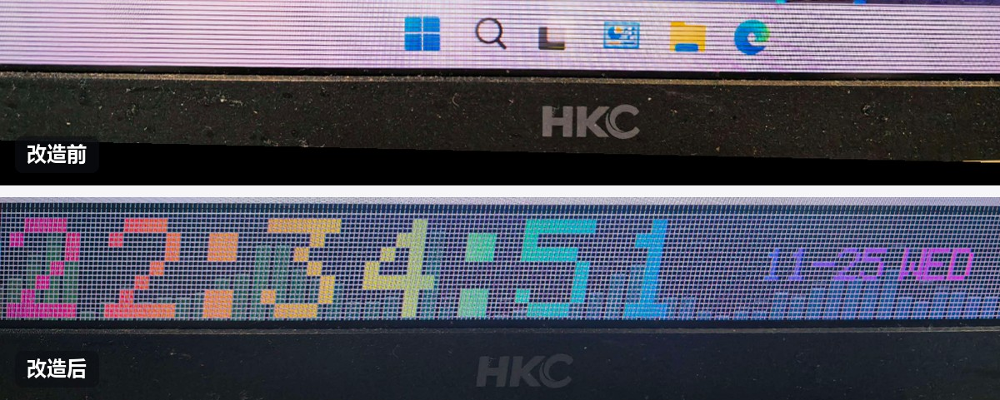

# DeadBand

> **The app UI is Chinese only.** A minimal English readme follows; the tutorial PDF shipped in the release is also Chinese.

Turns the dead strip at the bottom of a defective monitor into a useful info bar: a pixel clock, an audio spectrum, and Bilibili subtitles.



Two photos of the same panel. Top: the defect (fixed horizontal gray lines) cutting through the Windows taskbar. Bottom: the same 99 px band handed over to DeadBand — the bad lines are still there, but they are now part of a grid pattern.

It does **not** repair the panel (that's impossible). It reserves the already-ruined strip as a Windows **AppBar** (same mechanism the taskbar uses), paints content into it, and — the key trick — draws a vertical grid in the same color and pitch as the bad lines, so the horizontal defect becomes part of a visible lattice.

## Quick start

1. Download `DeadBand-v*-win64.zip` from [Releases](../../releases/latest)
2. Unzip it anywhere (don't run from inside the archive)
3. Run `DeadBand.exe`

On first launch a setup wizard runs: environment check → calibration → what to show → stacking rules → appearance → fullscreen & autostart → done. Takes about two minutes.

> **SmartScreen will warn you once.** The exe is unsigned, so Windows shows "Windows protected your PC" on first run. Click "More info" → "Run anyway". The full source is in this repo if you prefer to build it yourself.

## Requirements

- Windows 10 1903+ or Windows 11
- .NET Framework 4.8 (built into both; nothing to install)
- Single exe, architecture-independent

## What works, what doesn't

Works: defects that are confined to a band along the **bottom edge** of the screen.

Doesn't work: defects at the top, defects scattered across the middle, defects on the left/right edges. An AppBar can only reserve one of the four screen edges; reserving a strip in the middle is just covering content, not making room.

Subtitles come from a Tampermonkey userscript and only support the **Bilibili web player**. Audio spectrum reads WASAPI loopback; nothing is recorded or uploaded. The program listens on `127.0.0.1` only and never talks to the internet.

## Build from source

Needs the `csc.exe` that ships with .NET Framework 4.x (no Visual Studio):

```bat
build.cmd
```

Source must stay within **C# 5** syntax — the compiler is the one in `Framework64\v4.0.30319`, so no string interpolation, no `?.`, no expression-bodied members.

```bat
package.cmd     :: build + bundle the release zip
```

## License

[MIT](LICENSE) © 2026 GUGUQ1
