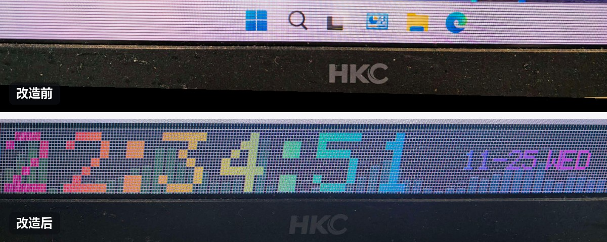
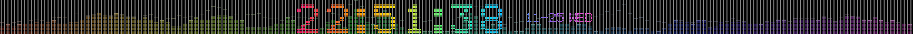
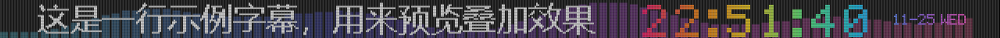
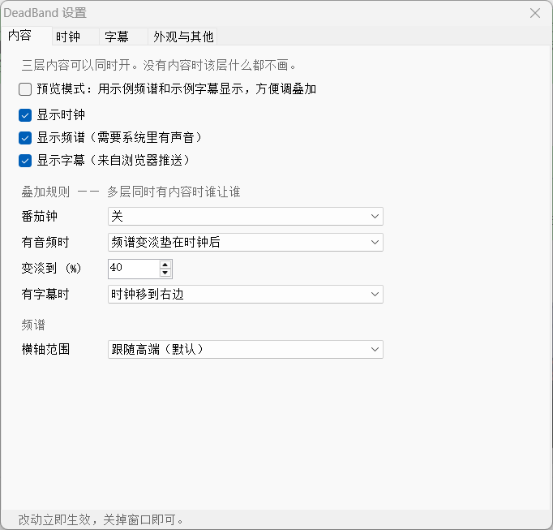

# DeadBand

把坏屏底部那条"废掉"的横条，变成一条真正有用的信息区：时钟、频谱、B站 字幕。



上面两张是同一块屏幕的实拍。上：坏线把任务栏切得像被扫描线扫过；下：同一块屏最底下 99px 交给 DeadBand 之后，横向坏线被"织"进了一张栅格里 —— 它还在，但看起来像设计的一部分。

> 一块 1440p 的 HKC T2752Q 用了几年之后，屏幕最底下每隔 4 行出现一条横向灰线。擦不掉、修不了，而它正好压在任务栏上。DeadBand 不是为了修屏幕（修不了），而是把这条已经废掉的区域向系统正式"占下来"，再往里面放东西。

---

## 它解决什么问题

坏屏里最难处理的是**坏线在屏幕最底下、又正好在任务栏位置**这种：

- 把任务栏挪走？那条区域留给谁？空着难看，放窗口又看不清。
- 把分辨率降一档？整块屏都糊了，为了底部几十像素不值得。

DeadBand 做三件事：

1. **占位**：注册成 Windows AppBar（跟任务栏同一套机制），把屏幕最底下一整条从可用工作区里划走。
2. **避线**：按固定行距算出坏线所在的行，把这些行清成底色，内容就像被"切开"。
3. **收编**：在同样的位置画出竖向的同色栅格。**横的坏线 + 竖的网格 = 一张网**，灰线不再是缺陷，而是图案的一部分。

第 3 步是整套做法里最关键的一步，也是它和"黑边遮住"这类土办法的区别。

## 快速开始

1. 到 [Releases](../../releases/latest) 下载 `DeadBand-v*-win64.zip`
2. 解压到任意目录（不要在压缩包里直接运行）
3. 双击 `DeadBand.exe`

第一次启动会**自动进入设置引导**，八步：环境预检 → 标定 → 显示什么 → 怎么叠 → 外观 → 全屏与开机启动 → 完成。全程两分钟左右。

> **Windows 会拦一次。** exe 没有代码签名，从浏览器下载的压缩包解压后第一次运行时，会弹「Windows 已保护你的电脑」。点「更多信息」→「仍要运行」即可。这是未签名程序的通用提示，不代表文件有毒；源码全部在这个仓库里，可以自己编译（见下文）。

详细的图文教程在压缩包里的 **`使用教程.pdf`**，也可以在浏览器里看 [docs/tutorial.md](docs/tutorial.md)。

## 它能做什么

| 能力 | 说明 |
|---|---|
| **像素时钟** | 5×7 点阵，字号自动贴合网格单元；可换字色、彩虹渐变、冒号闪烁 |
| **音频频谱** | 抓系统声音（WASAPI loopback），对数频率分布；有时钟时自动变淡垫在下面 |
| **B站 字幕 / 歌词** | 浏览器脚本把当前这句推给 DeadBand；后台播放、最小化都照常推进 |
| **番茄钟** | 独占总水位 / 叠加共存，带开始暂停按钮和结束提示音 |
| **背景网格** | 竖线与坏线同色同间距，把横线收编成栅格 |
| **全屏避让** | 检测到全屏窗口时把它压到区带上沿，视频完整可见（不吃避让的程序会退到覆盖显示） |
| **隐藏区带热键** | 全局热键（默认 `Ctrl+Alt+H`）随时收起 / 放回区带。收起时预留区整个还给桌面，音频采集也停掉 |
| **开机自启** | 写 HKCU 启动项，不需要管理员 |
| **多显示器热插拔** | 按显示器型号认人；外接屏拔掉时自动停用，插回来自动恢复 |



三层内容可以同时开（时钟 + 频谱 + 字幕），叠加规则可调：有音频时频谱变淡到多少、有字幕时时钟靠右还是隐藏。这层逻辑带迟滞，句子之间的空隙不会让时钟来回跳。



## 首次引导与标定


引导里会先做**硬预检**：如果任务栏还在屏幕底部，DeadBand 的区带会被顶到任务栏上方，位置和标定预览对不上 —— 这种情况会直接拦住，让你先去把任务栏挪走。


标定是整屏白底（灰线在白底上最清楚），分四步：预留区高度 → 坏线间距 → 坏线相位 → Enter 保存。屏幕上会一直标着现在在第几步，底下还有一行「现在做：」，说清这一步具体要干什么。

> 预留区高度不是随便填的：**它应该等于"最上面那条灰线距屏幕底边的距离"**。灰线往上蔓延得越高，这条带就要拖得越高。

## 设置



托盘右键 → `设置…`。四个标签页：内容 / 时钟 / 字幕 / 外观与其他。**改动即时生效**，没有确定取消，边调边看底部区带。

托盘菜单只有五项：显示时钟、显示频谱、显示字幕、番茄钟、设置…、退出。

## 适用 / 不适用

**适用**：坏线集中在**屏幕最底下一条带**里（这是最常见的一种），且这条带能正常显示内容、只是有横向灰线。

**不适用**（当前版本明确不支持）：

- 坏线在屏幕**顶部**或**中间散布**。DeadBand 靠"占住屏幕边缘"腾地方，AppBar 只能贴在四边之一，中间的窗口不叫腾地方，叫遮挡。
- **左右两侧**的竖向坏线（同一套机制可以扩展，但还没做）。
- 超过一台显示器同时运行（一次只服务一台，可以随时在引导里换）。

## 已知限制

| 限制 | 说明 |
|---|---|
| 字幕只支持 **B站 网页播放器** | 需要 Tampermonkey 扩展 + DeadBand 的浏览器脚本，其它播放器接不了 |
| 程序界面只有中文 | 英文 README 见 [README.en.md](README.en.md) |
| 程序未签名 | 首次运行会被 SmartScreen 拦一次，见"快速开始" |
| 无自动更新 | 想升级就下载新的 zip 覆盖 exe，配置文件不受影响 |
| 每台显示器一份配置 | 存在 `%LOCALAPPDATA%\DeadBand\profiles\`，按显示器型号命名 |

## 系统要求

- Windows 10 1903+ 或 Windows 11
- .NET Framework 4.8（这两个系统都自带，**不需要装任何运行库**）
- 单个 exe，不区分 32/64 位

## 隐私与网络

- 程序只监听 `127.0.0.1` 上的一个本地端口（默认 41723），用来接收浏览器推来的字幕。**不对外网开放，不上传任何数据。**
- 音频频谱读的是本机回环（loopback），不录音、不落盘。
- 配置和日志都在 `%LOCALAPPDATA%\DeadBand\`，删掉这个目录等于完全卸载干净。

## 从源码构建

需要 .NET Framework 4.x 自带的 `csc.exe`（Win10/11 都有），不需要 Visual Studio：

```bat
build.cmd
```

产物在 `dist\DeadBand.exe`。注意源码只能用 **C# 5** 语法（编译器是 `Framework64\v4.0.30319\csc.exe`，不支持字符串插值、`?.`、表达式体成员等）。

组发布包（含教程 PDF、许可证、压缩）：

```bat
package.cmd
```

改动 UI 之后请先跑自检，它会构造取色器、时钟设置、首次引导三个窗口，把控件重叠 / 文字被裁 / 被容器压住的问题写进诊断文件：

```bat
dist\DeadBand.exe --ui-check
```

更多见 [docs/development.md](docs/development.md)。

## 文档

| 文件 | 内容 |
|---|---|
| [docs/tutorial.md](docs/tutorial.md) | 图文教程（= 压缩包里的 `使用教程.pdf`） |
| [docs/faq.md](docs/faq.md) | 位置不对 / 字幕不来 / 杀软报警 / 怎么彻底卸载 |
| [docs/how-it-works.md](docs/how-it-works.md) | AppBar、坏线挖空、栅格收编、分层合成的原理 |
| [docs/development.md](docs/development.md) | 编译、C# 5 约束、源文件职责、诊断文件 |
| [CHANGELOG.md](CHANGELOG.md) | 版本改动 |

## 许可

[MIT](LICENSE) © 2026 GUGUQ1
