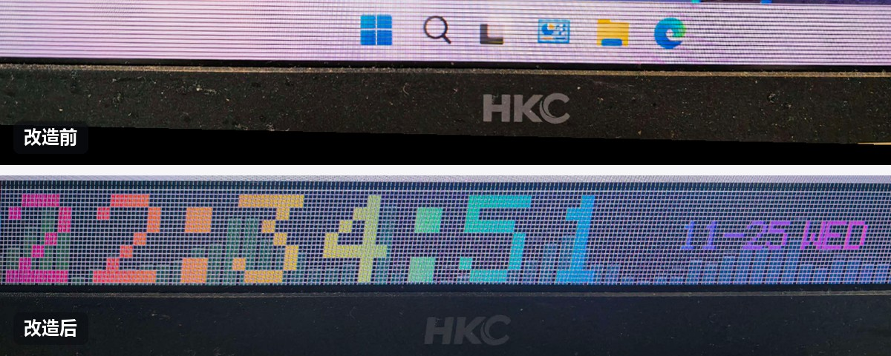
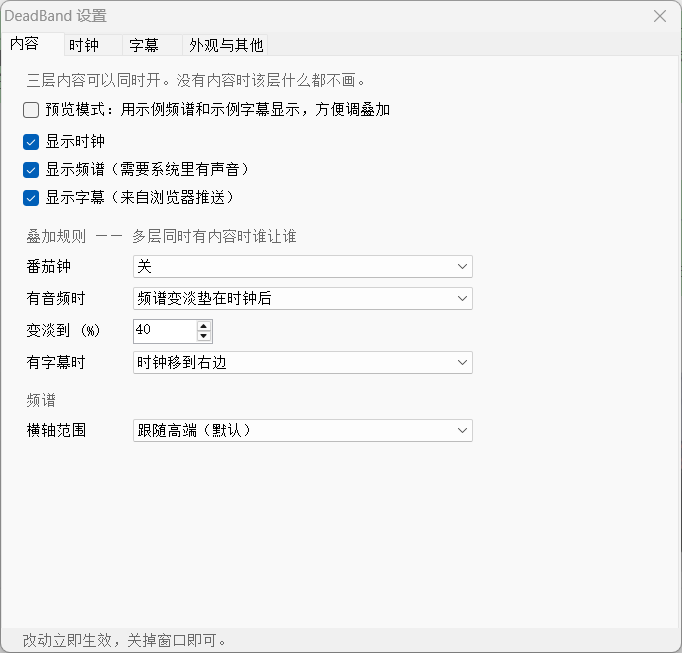
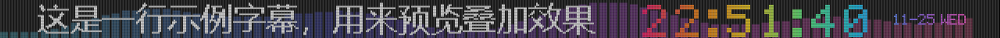

# DeadBand 使用教程

把一个坏掉的屏幕边缘，变成一条有用的信息条。

版本 1.0.0 ｜ © 2026 GUGUQ1

---

## 一、这是什么

有些显示器用久了，屏幕最底下每隔几行会出现一条横向的灰线。擦不掉、修不了，而它常常正好压在任务栏上 —— 那条区域基本等于废了。

DeadBand 不修屏幕（修不了），它做的是：**把这条已经废掉的区域向系统正式占下来，然后在里面放东西**。



同一块屏幕的两张实拍。上面是坏线原本的样子，它们把任务栏上的图标切得像被扫描线扫过。下面同一块屏幕的最底下 99 像素交给了 DeadBand：那条区域里现在是一座像素时钟，而横向的坏线被"织"进了一张竖线栅格里 —— 它还在，但看起来像设计的一部分。

这个"把它织进图案里"的做法，是 DeadBand 和"贴块黑边盖住"这类土办法的本质区别。

---

## 二、你的屏幕适不适合

开始之前请先确认三件事：

**1. 坏线集中在屏幕最底下一条带里。**

这是 DeadBand 唯一支持的情况，也是最常见的一种。如果你的坏线在屏幕顶部、在中间散布、或者两侧有竖向的条纹，当前版本帮不上忙：程序靠"占住屏幕的一条边"腾出空间，Windows 只允许它贴在四条边之一，贴在中间的窗口不叫腾地方，叫遮挡。

**2. 这条区域能正常显示，只是有横向灰线。**

不是全黑、不是花屏、不是整块区域触控或闪屏。DeadBand 只是往上面画东西，它没法让一块不出画面的区域出画面。

**3. 任务栏不在屏幕底部。**

DeadBand 要占最底下一整条，任务栏也在抢同一条边。Windows 会把后来者挤到上面去，于是区带会浮起来几十像素，位置和标定对不上。请先把任务栏挪到顶部或设为自动隐藏。

---

## 三、安装

1. 从 GitHub 的 Releases 页面下载 `DeadBand-v1.0.0-win64.zip`
2. **解压到任意目录**（不要在压缩包里直接双击运行）
3. 双击 `DeadBand.exe`

不需要安装任何运行库：程序基于 .NET Framework 4.8，Windows 10（1903 以后）和 Windows 11 都自带。

### 第一次运行会被 Windows 拦一次

程序没有代码签名（个人开源项目买不起证书），所以从网络下载的压缩包解压后第一次运行时，会弹出这个提示：

```
Windows 已保护你的电脑
   应用：DeadBand.exe
   发布者：未知
```

点 **「更多信息」**，再点 **「仍要运行」**。

这是所有未签名程序的通用待遇，不代表文件有问题。如果仍然不放心，仓库里有全部源码，可以自己用系统自带的编译器构建出完全相同的 exe。

---

## 四、第一次启动：设置引导

首次运行会自动进入引导，一共八步，大约两分钟：

| 步骤 | 你要做的事 |
|---|---|
| 1 欢迎 | 看一眼，确认三件事 |
| 2 环境预检 | 自动检查，通过就下一步 |
| 3 标定 | 对齐坏线（下面单独讲） |
| 4 显示什么 | 勾选要显示的层 |
| 5 怎么叠 | 多层同时出现时谁让谁 |
| 6 长什么样 | 打开背景网格 |
| 7 全屏与开机启动 | 按需勾选 |
| 8 完成 | 看摘要 |


第 2 步是**硬门槛**：如果屏幕底部还被别的东西占着（通常是任务栏），程序会直接拦住，不让你往下走。这不是刁难 —— 这一条不过，后面的位置怎么调都是错的。

预检通过之后，区带会立刻出现在屏幕底部，让你先看到"它会占掉这么一条"。

---

## 五、标定：把这四步走完

点「开始标定…」之后整屏会变成白色（灰线在白底上最清楚），中间是一块深色的提示面板。


面板上一直标着现在在第几步，底部那行洋红色的字是「现在做：」—— 它说明这一步具体要干什么。

**第一步 · 预留区高度**

拖动区带上沿那条青色线，把带的顶边拖到**最上面那条灰线的上方**。

这是整个标定里最重要的一步。很多人会停在默认的 100 像素，结果更高的那几条灰线还露在带子外面。记住一条：**带子的高度应该等于"最上面那条灰线距屏幕底边的距离"**。

**第二步 · 坏线间距**

按 Tab 切到「坏线间距」，用 ↑↓ 调。让屏幕上那些洋红色横线的**疏密**和真实灰线一致。

数一下：两条相邻灰线之间隔了几行？

**第三步 · 坏线相位**

间距对了之后，洋红线可能仍然和灰线错开半格。用「坏线相位」把它们挪到正好压住灰线。

**第四步 · 保存**

按 Enter 保存，Esc 取消（取消不会改动任何东西）。

> 操作速查：Tab 切换项目，↑↓ 调 1，Shift+↑↓ 调 10，滚轮微调当前项，C 换背景色，P 开预览。
>
> 灰线比 1 行粗的话，还有一项「坏线粗细」，调成相同行数即可。多数屏幕是 1 行。

---

## 六、显示什么 / 怎么叠

DeadBand 有四个可以同时存在的内容：时钟、频谱、字幕、番茄钟。



在设置窗口的「内容」页里勾选要开的层。没有内容时那一层什么都不画，不会留下空位。

**叠加规则**决定多层同时有内容时谁让谁：

| 选项 | 含义 |
|---|---|
| 有音频时 | 「频谱变淡垫在时钟后面」或「隐藏时钟」 |
| 变淡到 (%) | 垫在下面时的不透明度。数值越小越淡 |
| 有字幕时 | 「时钟移到右边」或「隐藏时钟」 |



上图就是"有字幕时时钟移到右边"的效果：左边是字幕，右边是时钟，频谱在底下淡着。

调这些规则时建议先打开「预览模式」—— 它用示例字幕和示例频谱代替真实内容，这样没声音、没在放视频的时候也能看出叠加效果。关掉设置窗口时预览会自动撤销。

---

## 七、外观：把坏线藏起来

这是 DeadBand 的核心技巧。

单独看，一条横向灰线是缺陷。但如果同样的位置还有一条条**同色的竖线**，人眼看到的就是一张规则的网格 —— 灰线成了格子的一条横边。

所以在「外观与其他」页里：

1. 勾上 **背景网格**
2. 勾上 **网格跟随坏线**（这样竖线间距等于坏线间距，栅格是正方形）
3. 点 **网格色…**，把网格色调到和屏幕上的灰线观感最接近

第 3 步是关键：取色器可以从屏幕像素上取色，也可以自己拉滑块，一边拖一边看底部区带的变化，调到"灰线看不出来"为止。

「坏线挖空」是另一件事：它把坏线所在的那几行清成底色，让内容看起来像被切开。配合网格使用效果最好 —— 挖空之后竖线会被补回来，栅格不会断。

---

## 八、字幕：目前只支持 B站

字幕的逻辑是：浏览器里的播放器把"当前这一句"推给 DeadBand，DeadBand 只负责显示。

所以要两样东西：**篡改猴扩展** + **DeadBand 的浏览器脚本**。

1. 在设置 → 字幕页点「先装篡改猴…」，按浏览器装好 Tampermonkey 扩展
2. 回到设置，点「在浏览器里安装 / 更新脚本」，浏览器会打开安装页，点安装
3. 在 B站 播放页把字幕打开（CC 字幕或 AI 字幕都行）
4. 回到 DeadBand，勾上「显示字幕」

> 没装篡改猴就去点脚本，浏览器只会给你看一段代码 —— 这是最常见的卡点。

**只支持 B站 网页播放器**，其它站点、其它播放器都接不了。

顺带一个好处：因为脚本是按视频时间轴推句子的，所以**后台播放、最小化窗口、切到别的标签页，字幕都照常往下走**。

---

## 九、全屏、开机启动与托盘

**全屏视频**：DeadBand 的区带不会消失。检测到全屏窗口时，程序会把那个窗口压到区带上沿，让画面完整显示在带子上面。

有个别程序不吃这一套（死活不让改窗口尺寸），这种情况会退化成"覆盖显示"—— 区带压住画面最底下那一条，并弹一次提示告诉你。

**开机自动启动**：引导第 7 步默认勾选。它写的是当前用户的启动项（`HKCU\...\Run`），不需要管理员权限。想关掉：设置窗口里的同一个勾，或者任务管理器 → 启动 → 禁用 DeadBand。

**托盘菜单**（右键任务栏里的图标）：

```
显示时钟
显示频谱
显示字幕
番茄钟 ▸ 关 / 独占 / 共存
设置…
退出
```

双击图标也是打开设置。

**隐藏 / 恢复区带**：默认热键 `Ctrl+Alt+H`，**任何时候都能按** —— 别的程序在前台、全屏播放、打游戏都生效。

按一下区带消失，那条预留区整个还给桌面（窗口可以铺满屏幕）；再按一下回来。

- 隐藏时音频采集线程也会停掉，等于完全不占资源
- 区带隐藏时，鼠标停在托盘图标上会提示按哪个键恢复
- 想换组合键：设置 → 外观与其他 → 「隐藏区带热键」，点一下按钮，直接按下你想要的组合键；点「清除」可以不用热键
- 组合键必须是「修饰键 + 一个键」。如果选的键正好被别的软件占用了，程序会弹提示告诉你换一个

---

## 十、常见问题

**位置不对？** 先看任务栏是不是还在屏幕底部。

**字幕一直是示例文字？** 设置 → 内容 → 取消「预览模式」。

**字幕一句都不来？** 依次检查：播放器里字幕开了吗、篡改猴装了吗、脚本装了吗、是不是 B站。

**杀软报警？** 未签名程序的通用提示，见第三节。不放心就自己编译。

**怎么彻底卸载？**

1. 托盘右键 → 退出
2. 设置 → 外观与其他 → 取消「开机自动启动」
3. 删掉程序目录
4. 删掉 `%LOCALAPPDATA%\DeadBand`
5. 浏览器里卸载篡改猴脚本

**配置在哪？** `%LOCALAPPDATA%\DeadBand\`。里面是按显示器型号命名的 `profiles\*.ini`，纯文本，可以直接编辑。

---

## 关于这个项目

DeadBand 是 MIT 许可的开源项目，源码、问题反馈都在 GitHub：

```
https://github.com/GUGUQ1/DeadBand
```

它最初只是为了一块用了几年、底部开始出灰线的 HKC 显示器写的。如果你的屏幕坏法不一样（顶部、中间、竖向），当前版本帮不上忙 —— 但欢迎在 Issues 里说说你的情况。
